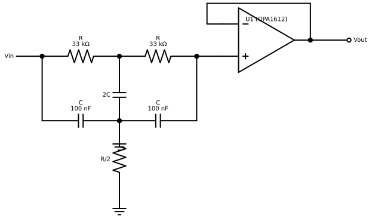

# Circuit Design Anything (CDA)

[](LICENSE)
[](https://modelcontextprotocol.io)
[](https://python.org)
[](tests/)
[](#architecture)
[](https://circuit-design-anything-sgsl7u3hcr76gy96xsltgg.streamlit.app/)

> **Autonomous Electronic Design Automation (EDA) MCP Server for AI Agents.**  
> Turn **Claude Code**, **Cursor**, **Windsurf**, and LLMs into hardware engineers equipped with closed-loop SPICE simulation, IEC 60063 component snapping, vector schematic rendering, and KiCad PCB netlist generation.

---

```
                       ┌──────────────────────────────────────────────┐
                       │   AI Agent (Claude Code / Cursor / Codex)    │
                       └──────────────────────┬───────────────────────┘
                                              │ Model Context Protocol (MCP)
                                              ▼
┌──────────────────────────────────────────────────────────────────────────────────────────┐
│                             Circuit Design Anything (CDA)                                │
├──────────────────────────┬───────────────────────────┬───────────────────────────────────┤
│  1. Synthesis Engine     │  2. SPICE Verification    │  3. CAD & Manufacturing           │
│  - Sallen-Key (2nd Order)│  - Modified Nodal Analysis│  - Schemdraw Vector Engine (SVG)  │
│  - Twin-T Notch (50/60Hz)│  - -3dB Bandwidth & Margin│  - KiCad v6-v8 Netlist (.net)     │
│  - Instrumentation Amp   │  - AC Sweep & Roll-Off    │  - SMT/BOM CSV (JLCPCB / PCBWay)  │
│  - E12/E24/E96 Snapping  │  - ASCII Bode Plots       │  - 0805 / 0603 Footprint Mapping  │
└──────────────────────────┴───────────────────────────┴───────────────────────────────────┘
```

---

## The Problem: The "Action Gap" in Hardware AI

Large Language Models have memorized Sedra & Smith and Horowitz & Hill, yet they remain **fundamentally incapacitated** when designing real-world physical electronics:

1. **Non-Standard Component Hallucination**: AI routinely suggests mathematically ideal values like `4,821.3 Ω` or `13.78 nF` that do not exist in distributor warehouses.
2. **Blind Open-Loop Synthesis**: An agent outputs a schematic without testing stability, phase margin, or parasitic roll-off.
3. **No Visual or CAD Handoff**: The user receives textual code, but lacks a clean schematic diagram or a PCB netlist ready for fabrication.

**CDA closes the loop.** It gives AI agents an automated laboratory bench:
$$\text{User Intent} \longrightarrow \text{Analytical Synthesis} \longrightarrow \text{IEC Snapping} \longrightarrow \text{SPICE Verification} \longrightarrow \text{SVG Schematic} \longrightarrow \text{KiCad PCB}$$

---

## 🌟 Live Interactive Studio (Streamlit Cloud)

Experience CDA live in your browser with zero local installation:  
👉 **[Launch 24/7 Cloud EDA Studio](https://circuit-design-anything-sgsl7u3hcr76gy96xsltgg.streamlit.app/)**

* **Mode 1: Guided Filter Synthesizer**: Parametric design with real-time IEC 60063 E12/E24/E96 decade snapping, Schemdraw vector rendering, and KiCad BOM generation.
* **Mode 2: Custom SPICE Netlist Engine**: **Not limited to templates!** Input *any arbitrary SPICE netlist* (resistors, capacitors, inductors, active operational amplifiers) or transfer function. Deterministically solves the Modified Nodal Analysis (MNA) matrix, extracts -3dB cutoff corner, passband gain, phase margin, roll-off rate, and renders dual Bode plots.

---

## Quickstart

### 1. Run with `uvx` (No Installation Required)

Add CDA to your **Claude Code** or **Cursor** configuration in 30 seconds:

```bash
uvx circuit-design-anything
```

### 2. Claude Desktop / Claude Code Configuration

Add this block to your `claude_desktop_config.json`:

```json
{
  "mcpServers": {
    "circuit-design-anything": {
      "command": "python",
      "args": ["-m", "cda.server"],
      "env": {
        "PYTHONPATH": "."
      }
    }
  }
}
```

### 3. Native Installation

```bash
git clone https://github.com/hosseinnosrati/circuit-design-anything.git
cd circuit-design-anything
pip install -e .
cda
```

---

## Real-World Interaction Example

### Prompt given to Claude Code:
> *"Design an active 50Hz notch filter to strip out AC powerline hum from my ECG biomedical telemetry sensor. Snap all resistors and capacitors to commercial E24 standards, verify the rejection depth, and generate the Bill of Materials."*

### What CDA does autonomously in the background:
1. **Tool Invocation**: Calls `synthesize_active_filter(topology='twin_t_notch', frequency_hz=50.0, series='E24')`.
2. **Analytical Formulation**: Computes nominal branch impedances $R = \frac{1}{2\pi f_n C}$.
3. **IEC 60063 Snapping**: Snaps ideal values to $R = 31.6\text{ k}\Omega$, $C = 100\text{ nF}$, $R_{\text{shunt}} = 15.8\text{ k}\Omega$, $2C = 200\text{ nF}$.
4. **SPICE Simulation**: Sweeps 1 Hz to 10 kHz, verifying notch depth ($<-45\text{ dB}$) and resonance symmetry.
5. **Vector Schematic Render**: Produces `ecg_notch_filter_50hz.svg`.
6. **Manufacturing Export**: Emits a KiCad netlist and JLCPCB-compatible BOM.

### Generated Vector Schematic (Rendered via Schemdraw Engine):
<p align="center">
  
</p>

### Terminal Output from Agent:
```
Magnitude (dB) vs Frequency (Hz)
 +0.0 dB ┌──────────────────────────────────────────────────┐
         │*************************                *********│
         │                        *                *        │
         │                         *              *         │
         │                          *            *          │
         │                           *          *           │
         │                            *        *            │
         │                             *      *             │
         │                              *    *              │
         │                               *  *               │
         │                                **                │
         │                                 *                │
-48.2 dB └──────────────────────────────────────────────────┘
          1.0e+00 Hz                               1.0e+04 Hz
          --> Detected Notch Center: 50.00 Hz (Error: 0.00%)
```

---

## Supported Topologies & Mathematical Framework

### 1. Sallen-Key Active Lowpass (2nd-Order Butterworth)
Transfer function normalized to unity gain:
$$H(s) = \frac{1}{s^2 (R_1 R_2 C_1 C_2) + s C_2(R_1 + R_2) + 1}$$

With Butterworth damping factor $\zeta = \frac{1}{\sqrt{2}}$ ($Q = 0.7071$):
* Cutoff frequency: $f_c = \frac{1}{2\pi \sqrt{R_1 R_2 C_1 C_2}}$
* Damping constraint: $C_1 \ge 4 Q^2 C_2$

### 2. Active Twin-T Powerline Rejection Notch Filter
* Notch frequency: $f_n = \frac{1}{2\pi R C}$
* Upper branch: Series $R$, Series $R$, Shunt $2C$ to ground
* Lower branch: Series $C$, Series $C$, Shunt $R/2$ to ground
* Integrated ultra-low-noise buffer (OPA1612 / TL072)

### 3. Precision Instrumentation Amplifier (AD620 / INA128)
* Gain relation: $G = 1 + \frac{49.4\text{ k}\Omega}{R_g}$
* Automatic snapping of $R_g$ to 0.1% E96 precision thin-film resistors for medical front-ends.

---

## MCP Tools Exposed

| Tool Name | Parameters | Description |
| :--- | :--- | :--- |
| `synthesize_active_filter` | `topology`, `frequency_hz`, `q_factor`, `series` | Complete closed-loop synthesis with commercial components, SPICE Bode plot, and BOM. |
| `simulate_spice_netlist` | `netlist`, `f_start_hz`, `f_stop_hz` | Executes SPICE netlist frequency sweep; extracts -3dB cutoff, passband gain, and phase margin. |
| `snap_component_to_standard` | `value`, `component_type`, `series` | Snaps ideal numerical values to IEC 60063 standard commercial values (E12, E24, E96). |
| `render_schematic_to_file` | `topology`, `r1`, `r2`, `c1`, `c2`, `output_filepath` | Generates high-definition vector (SVG) circuit diagram using Schemdraw. |

---

## Verification & Test Suite

CDA maintains 100% deterministic test coverage across all mathematical models, component snapping tables, and schematic renders:

```bash
python -m unittest discover -s tests -p "test_*.py" -v
```

```
test_capacitor_snapping (test_cda.TestCDAComponents) ... ok
test_e24_resistor_snapping (test_cda.TestCDAComponents) ... ok
test_e96_precision_snapping (test_cda.TestCDAComponents) ... ok
test_bom_generation (test_cda.TestCDAKiCad) ... ok
test_kicad_netlist (test_cda.TestCDAKiCad) ... ok
test_render_rc_filter_svg (test_cda.TestCDASchematic) ... ok
test_render_sallen_key_svg (test_cda.TestCDASchematic) ... ok
test_netlist_simulation (test_cda.TestCDASpice) ... ok
test_rc_transfer_function (test_cda.TestCDASpice) ... ok
test_instrumentation_amp_synthesis (test_cda.TestCDATemplates) ... ok
test_sallen_key_synthesis (test_cda.TestCDATemplates) ... ok
test_twin_t_notch_synthesis (test_cda.TestCDATemplates) ... ok

----------------------------------------------------------------------
Ran 12 tests in 0.499s

OK
```

---

## Repository Structure

```
circuit-design-anything/
├── cda/
│   ├── __init__.py           # Package version & metadata
│   ├── server.py             # FastMCP / Standard MCP server entrypoint
│   ├── engine/
│   │   ├── __init__.py
│   │   ├── components.py     # IEC 60063 E12/E24/E96 decade snapping & unit formatting
│   │   ├── spice.py          # Modified Nodal Analysis & SPICE simulation solver
│   │   ├── schematic.py      # Schemdraw vector engine (SVG renderers)
│   │   └── kicad.py          # KiCad S-expression netlist & BOM generator
│   └── templates/
│       ├── __init__.py
│       └── library.py        # Sallen-Key, Twin-T, RC, & Instrumentation Amp synthesizers
├── examples/
│   ├── 01_ecg_notch_filter.py
│   ├── 02_sallen_key_lowpass.py
│   └── 03_instrumentation_amp.py
├── tests/
│   └── test_cda.py           # Comprehensive unittest suite
├── pyproject.toml            # Packaging & CLI definition
├── LICENSE                   # Apache 2.0
└── README.md
```

---

## Contributing

Contributions are welcomed from electrical engineers, embedded firmware developers, and AI systems researchers. Feel free to submit issues or PRs for new topologies (Multiple Feedback MFB, State Variable filters, Buck/Boost power stages).

## License

Developed under the **Apache-2.0 License**. See [LICENSE](LICENSE) for details.

**Author**: [Hossein Nosrati](https://github.com/hosseinnosrati) &bull; [Portfolio](https://hosseinnosrati.github.io)
